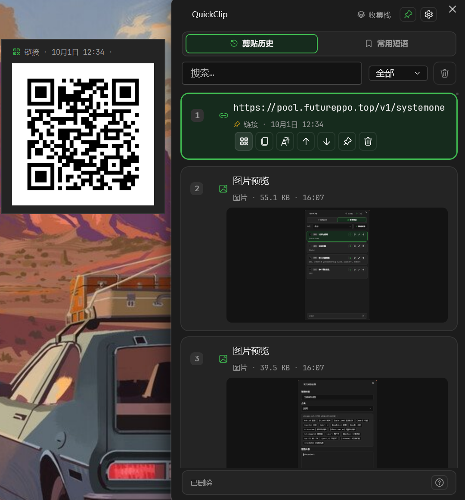
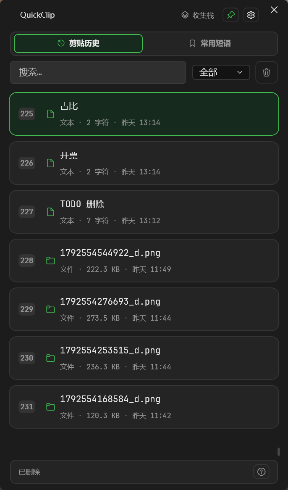
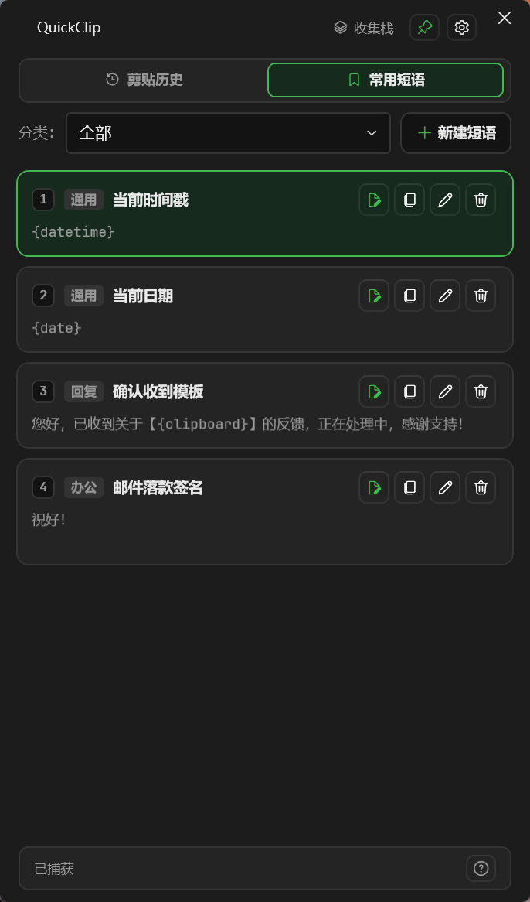
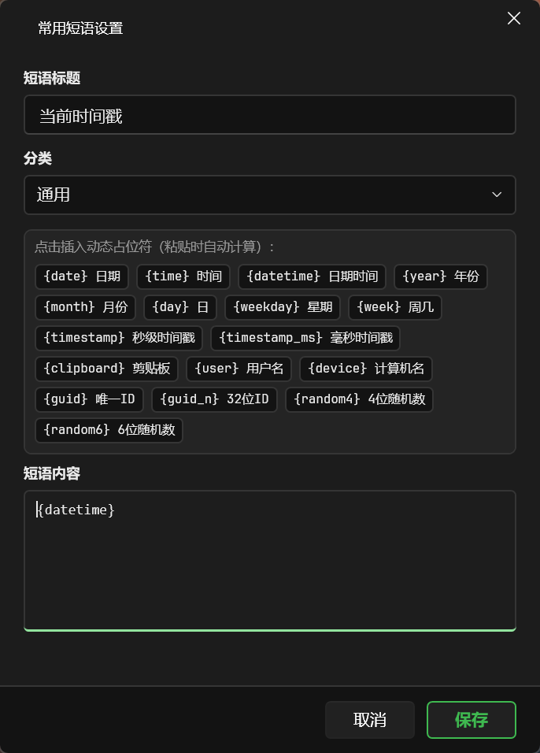

# QuickClip

<p align="center">
  Windows 的剪贴板历史，按原来的 <code>Win + V</code> 打开，内容只留在这台电脑上。
</p>

<p align="center">
  <a href="LICENSE"></a>
  <a href="https://dotnet.microsoft.com/download/dotnet/8.0"></a>
  <a href="docs/SPECIFICATION.md#五-系统兼容性渲染降级与运行环境"></a>
  <a href="https://github.com/soldier-cv/quick-clip/stargazers"></a>
  <a href="https://github.com/soldier-cv/quick-clip/releases/latest"></a>
  <a href="https://gitee.com/huaxudong/quick-clip"></a>
</p>

<p align="center">
  
</p>

---

## 为什么做

Windows 自带的剪贴板历史用 `Win + V` 就够顺手，但我平时不够用：记不住几条，也搜不了。QuickClip 换成它的位置，这个键还是原来的键。

复制过的内容只存在这台电脑上，不上传，也没有账号。手机上的内容如果要过来，用微信输入法、搜狗输入法这一类工具就行，它们会把文字放进电脑的剪贴板，QuickClip 接着记下。

退出或卸载之后，Windows 原来的剪贴板设置会还原。

## 安装

需要 [.NET 8 桌面运行时 (x64)](https://aka.ms/dotnet/8.0/windowsdesktop-runtime-win-x64.exe)。已经装过就跳过。

下载 `QuickClip-Setup-win-x64.exe`：

- [Gitee](https://gitee.com/huaxudong/quick-clip/releases)（国内）
- [GitHub](https://github.com/soldier-cv/quick-clip/releases)

装好后照常复制。要贴以前的内容时，按 `Win + V`，选中后按 `Enter`，或者双击。

## 日常使用

- **打开和关掉。** 在任何窗口按 `Win + V`，选完就回到刚才的窗口。第一次按下不用等，开机时窗口已经准备好了。
- **搜索。** 记得复制过，但想不起原句。打几个字就行；中文可以打拼音首字母，`sjjg` 能找到「设计架构」。
- **贴回去。** 从网页复制的一段，贴回 Word 时排版还在。贴进终端或代码编辑器时按 `Shift + Enter`，只贴文字。前 9 条不用选，直接按 `1` 到 `9`。
- **拖出去。** 一张图要丢进聊天窗口，按住卡片拖过去，不用先保存成文件。文字拖进输入框也一样。拖动时内容跟着指针。
- **备注。** 同样一段配置复制了三次，过后分不清哪次是哪次。右键写一句「测试环境」。下次搜这句就能找到。备注只给你自己看，贴出去的还是原来的内容。
- **置顶。** 一个地址这周要反复贴。钉住之后它一直在最上面，不会被后面的复制挤走。顺序不对就上移、下移一位。
- **先别记。** 要复制密码了。先在托盘里暂停，贴完再打开，这条就不会留在历史里。

其余按键见下面的表。除了 `Win + V` 和数字键，都可以在设置里改。

## 还可以

- **一次贴很多条。** 表格里有十个格子要填，内容散落在网页和聊天记录里。打开收集栈（`Ctrl + Shift + S`），按顺序复制好，到表格里连续按 `Ctrl + V`，一个格子一条。多行文字可以按行拆开。最后一条贴完后，再按一次不会重复贴。
- **常用短语。** 每天要发的那句回复，不用再翻上一封。保存成短语，下次点一下。里面写 `{date}`，贴出去就是今天的日期。偶尔要改两个字，贴之前改，保存的那一条不动。
- **图片。** 截图要留给同事，点一下就按日期存进文件夹，下次还能在文件夹里直接定位。对照着画图时，把图钉在桌面上，滚轮放大，按住 `Ctrl` 滚动把它调淡，底下的窗口还能看见。
- **二维码。** 电脑上操作，网页里是一个二维码，以前得截图、找解码网站、再打开链接。现在截完图，卡片上直接出现里面的文字，点一下就复制。反过来，电脑上的一段文字要给手机，悬停生成二维码，扫一下就到了。
- **识字。** 一张截图里有一段字，选不中、复制不了。点识别，改掉认错的字，再复制。
- **翻译。** 复制来的一段英文要贴进回复里。在卡片上翻成中文，确认后直接贴出去，不用再打开翻译网页。识字和翻译可以用系统自带的，也可以填你自己的模型接口。
- **面板位置。** 一块屏幕上窗口已经很多，面板每次都出现在屏幕右侧，不挡正在看的内容。也可以让它出现在鼠标旁边，或者记住上次放的地方。

---

## 界面

<p align="center">
  
</p>

<p align="center">
  
</p>

<p align="center">
  
</p>

<p align="center">
  
</p>

---

## 快捷键

| 按键 | 作用范围 | 说明 |
| :--- | :--- | :--- |
| `Win + V` | 全局 | 打开 / 隐藏 QuickClip 主面板 |
| `Enter` | 主面板 | 粘贴选中条目（保留富文本样式与文件对象） |
| `Shift + Enter` | 主面板 | 纯文本粘贴（剥离网页/Word 格式或提取文件纯路径） |
| `1` ~ `9` | 主面板 | 极速直贴列表第 1～9 项 |
| `↑` / `↓` | 主面板 | 顺次上下移动选中项 |
| `Ctrl + C` | 主面板 | 仅将选中项复制回系统剪贴板，不触发自动粘贴 |
| `Delete` | 主面板 | 删除选中条目（同步清理缩略图） |
| `Ctrl + P` | 主面板 | 切换窗口置顶（保持面板常驻，适合连续填表） |
| `Ctrl + Shift + V` | 全局 | 纯文本贴出当前剪贴板最新内容 |
| `Ctrl + Shift + S` | 全局 | 开启 / 关闭收集栈（顺次粘贴会话） |
| `Ctrl + V` | 收集栈激活时 | 按出栈顺序顺次贴出下一条 |
| `Esc` | 任意窗口 | 隐藏面板 / 退出收集栈 / 关闭贴图或弹窗 |

---

## 常见问题

<details>
<summary><strong>按 Win + V 无法呼出或弹出了 Windows 自带剪贴板？</strong></summary>

1. 检查桌面右下角系统托盘是否已有 QuickClip 图标；若未运行，从开始菜单启动。  
2. 若弹出的是系统自带剪贴板，请打开 QuickClip「设置 → 常规」，勾选「接管系统剪贴板」。  
3. 若目标窗口为管理员权限（高完整性级别），请将 QuickClip 也以管理员权限运行，以避免系统跨权限拦截快捷键。
</details>

<details>
<summary><strong>手机复制的内容，电脑上可以自动看到吗？</strong></summary>

QuickClip 自己不同步，也不上传。微信输入法、搜狗输入法这类工具可以把手机上的文字放进电脑剪贴板，放进来之后会被记进历史。
</details>

<details>
<summary><strong>剪贴板数据保存在哪里？如何彻底卸载？</strong></summary>

- **数据存放**：所有配置、数据库与图片缓存均保存在 `%LOCALAPPDATA%\QuickClip\` 目录中，不污染其他路径。  
- **安全卸载**：通过系统「应用和功能」正常卸载，卸载程序会自动按备份还原 Windows 系统自带剪贴板与注册表设置。
</details>

<details>
<summary><strong>如何检查与获取版本更新？</strong></summary>

在 QuickClip 托盘图标右键菜单中点击「检查更新…」，或在「设置 → 关于」中检查。发现新版本将通过国内高速镜像自动下载并无感升级。
</details>

---

## 🛠️ 从源码构建

开发运行环境需安装 [.NET 8 SDK](https://dotnet.microsoft.com/download/dotnet/8.0) 及 Windows 10 (1809+) / Windows 11。

```powershell
# 本地运行与调试
dotnet run --project src/QuickClip/QuickClip.csproj

# 本地发布 Release 独立包
dotnet publish src/QuickClip/QuickClip.csproj -c Release -r win-x64 --self-contained false `
  -p:PublishSingleFile=false -o publish/fdd
```

安装包使用 Inno Setup 编译 `setup/QuickClip.iss`。

---

## 📚 文档导航

| 文档 | 内容 |
| :-- | :-- |
| [docs/SPECIFICATION.md](docs/SPECIFICATION.md) | 产品定位、功能全景矩阵、核心架构与系统兼容性基线 |
| [AGENT.md](AGENT.md) | 开发准则、C# 编码规范与常用命令速查 |
| [CHANGELOG.md](CHANGELOG.md) | 逐版本更新记录与修复明细 |
| [docs/preview.html](docs/preview.html) | 界面结构与配色预览页 |

---

## 🤝 参与贡献

欢迎提交缺陷修复与改进建议：

- **反馈问题**：通过 [Issue 模板](.github/ISSUE_TEMPLATE) 提交缺陷报告或功能建议，请尽量附上复现步骤与系统版本。
- **提交代码**：Fork 本仓库后开分支开发，按 [PR 模板](.github/pull_request_template.md) 提交 Pull Request，并确保本地 `dotnet build QuickClip.sln -c Debug` 零错误零警告。

---

## 🙏 致谢与开源协议

感谢 [@wlight](https://github.com/wlight) 以及所有提出反馈、贡献 Star 的朋友。 
在功能探索上，从 Linux.do OneClip作者分享了解到有收集栈（批量顺次粘贴）的使用需求。
界面采用 [WPF-UI](https://github.com/lepoco/wpfui) 现代化控件库构建。

本项目基于 [MIT 许可证](LICENSE) 开源发布。
